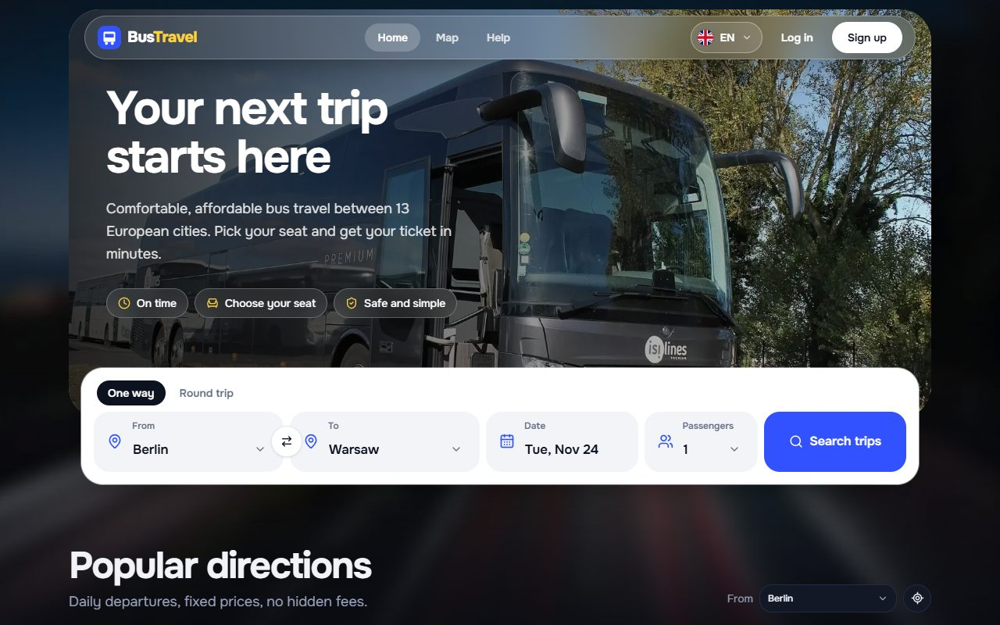
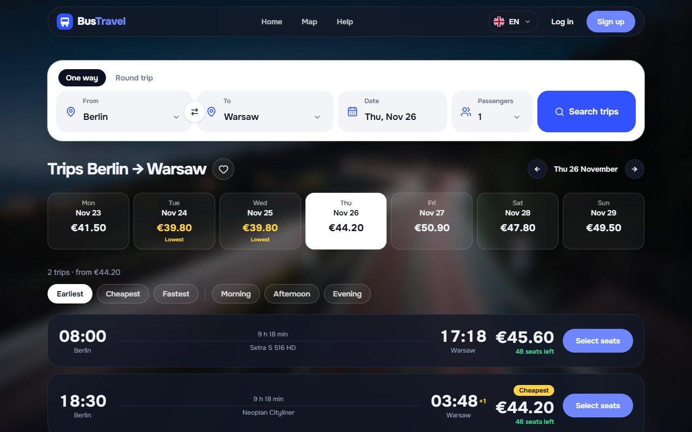
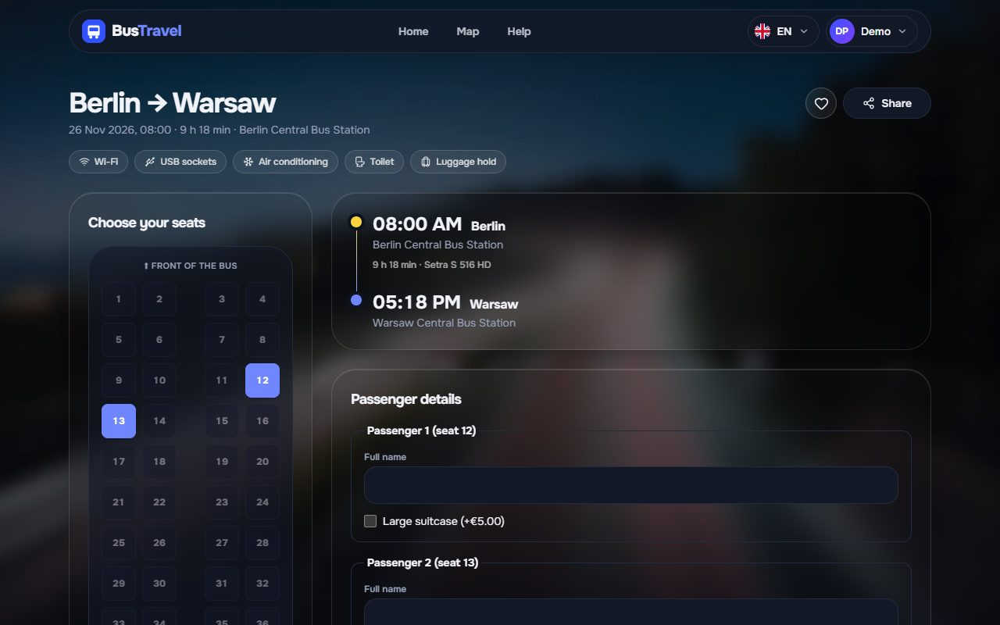
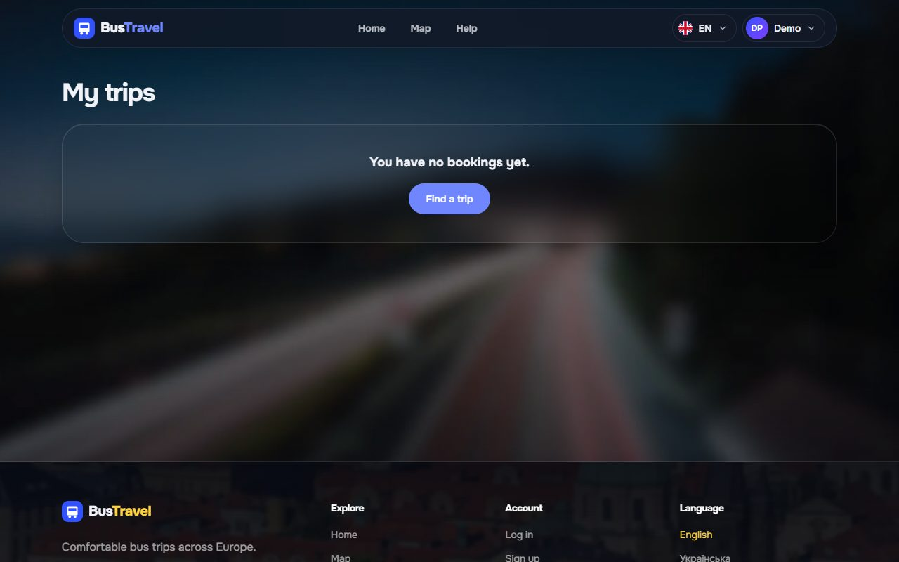
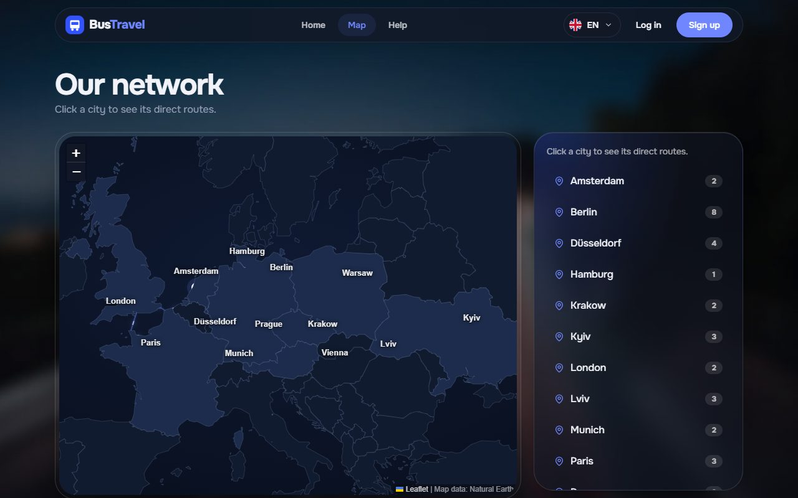
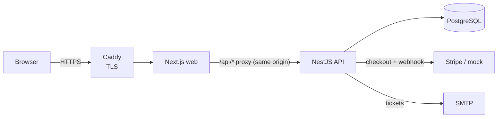

# BusTravel

Intercity bus booking: search trips, pick seats on a seat map, pay, get a QR ticket that the driver validates at boarding.
Available in English, Ukrainian, German and Polish.

> **Background.** A ground-up rewrite of an earlier side project (Express + MongoDB + Create React App).
> The idea and the domain stayed; the stack, architecture, data model, UI and delivery pipeline are new. See [docs/MIGRATION_FROM_V1.md](docs/MIGRATION_FROM_V1.md).

> **Test mode: no real money moves and no real tickets are sold.** Payments run through a built-in demo checkout (or Stripe test keys, where cards like `4242 4242 4242 4242` are fake).
> Every payment, ticket and email in the app says so. Never enter real card data.

## Screenshots

| Home | Search results |
|---|---|
|  |  |
| **Seat selection** | **My trips** |
|  |  |



## Features

* Search with one-way / round-trip, a lowest-price-per-day strip, sorting and time-of-day filters, saved routes and recent searches.
* Seat map, passengers with luggage options, a 30-minute seat hold, QR ticket, `.ics` calendar export, print layout.
* Round trip: outbound and return are booked in one flow and paid together (demo checkout).
* Reviews: only the owner of a **paid** booking can review it, one review per booking (enforced on the server); ratings of A→B and B→A are shown together.
* Dynamic pricing by weekday and time of day, 4 languages, a custom accessible dropdown and calendar, a map on real road geometry.
* Admin area: revenue and occupancy dashboard, sortable bookings (cancel with refund, resend ticket), trips (change price, cancel), routes and recurring schedules, user roles, and owner-only invitations of new administrators by e-mail.
* Driver ticket validation, branded ticket e-mails in 4 languages, SEO (Open Graph, sitemap, hreflang), lazy-loaded images, translations and code, and a search page without layout shift.

## Stack

| Layer | Technology |
| --- | --- |
| Web | Next.js 16 (App Router), React 19, TypeScript, Tailwind CSS 4, next-intl (4 languages), Leaflet map |
| API | NestJS 11, TypeScript, class-validator, Swagger (`/api/docs`), Throttler (rate limiting), Helmet |
| Data | PostgreSQL 17, Prisma 7 (versioned SQL migrations) |
| Auth | JWT access token (15 min) + rotating refresh token, both in httpOnly cookies; roles USER / DRIVER / ADMIN |
| Payments | Provider interface with `mock` (demo) and `stripe` (Checkout + signed, idempotent webhook) |
| Quality | Jest end-to-end tests against a real PostgreSQL, Playwright browser tests, strict TypeScript |
| Delivery | Docker (multi-stage, non-root), GitHub Actions CI/CD, GHCR, Caddy (auto-HTTPS), staging + production |



The browser only ever talks to one origin. Next.js proxies `/api/*` to the API over the private network, so the auth cookies are
first-party and httpOnly (page JavaScript, and therefore XSS, can never read a token) and no CORS is needed in production.

## What is interesting in the code

* **Double-booking is impossible, even under load.** `BookingSeat` has a unique `(tripId, seatNumber)` constraint and a booking inserts its seats
  in the same statement. Of N concurrent requests for one seat exactly one wins and the rest get `409 SEAT_TAKEN` (there is a test with 8 parallel requests).
* **Seat holds.** An unpaid booking holds its seats for 30 minutes; a cron job (and every new booking on that trip) releases expired holds.
* **Webhooks are idempotent.** Each provider event id is stored once (`PaymentEvent`); a payment arriving after the hold expired is refunded automatically.
* **Tickets cannot be forged.** The QR payload is `BT1.<code>.<hmac>`; validity is checked against the database at scan time, so a cancelled ticket stops working immediately.
* **Recurring schedules.** `TripTemplate` (time + weekdays) is materialised into concrete trips by an idempotent job; replaces the old `isDaily` flag.
* **Translations as data.** City names are a JSONB column (`{en, uk, de, pl}`), not `nameEN / nameUA` column pairs.
* **Fail-fast config.** The API refuses to start with missing/short secrets, or with the mock payment provider in production.

## Run locally

Requires Node 22+. **No Docker and no system-wide PostgreSQL needed**: an embedded PostgreSQL is started on demand (and only when you run the command).

```bash
npm install
cp apps/api/.env.example apps/api/.env      # set the three secrets (>= 32 chars), DATABASE_URL port 5433

npm run db:local -w apps/api                 # terminal 1: PostgreSQL on :5433 (Ctrl+C stops it)
cd apps/api && npx prisma migrate deploy && npm run db:seed   # once: schema + 13 cities, 38 routes, ~2100 trips
npm run dev:api                              # terminal 2: API on :4000  (Swagger: /api/docs)
npm run dev:web                              # terminal 3: web on :3000
```

E-mails are saved as HTML files in `apps/api/.mail` while `SMTP_HOST` is empty; set the `SMTP_*` variables to send them for real.

Demo accounts (seed, development only; password `Demo1234!`): `demo@bustravel.local`, `driver@bustravel.local`, `admin@bustravel.local`.

With Docker instead: `docker compose up --build` (starts Postgres, runs migrations, API and web on localhost).

## Tests

```bash
npm run test:e2e -w apps/api        # 12 API tests, boots its own throw-away PostgreSQL if DATABASE_URL is not set
cd apps/web && npx playwright test  # 7 browser tests: booking, round trip, reviews, admin area, driver flow  (PW_CHANNEL=msedge reuses an installed browser)
```

## Environments and delivery

```
feature branch --PR--> main (CI must pass) --auto--> STAGING
                         tag v1.2.3 --approval--> PRODUCTION   (the very same image, never rebuilt)
```

* **CI** (`.github/workflows/ci.yml`): typecheck, migration-drift check, API e2e on PostgreSQL, web build, browser tests, Docker build.
* **CD** (`.github/workflows/deploy.yml`): build once, tag images with the commit SHA, push to GHCR, deploy over SSH.
  The deploy script backs up the database, runs migrations, waits for a healthy `/api/health` through the public URL, and **rolls back automatically** if it never turns healthy.
* Staging and production are identical except for their `.env` (secrets, domain, payment provider) and their database.

Details, server setup, secrets and rollback: [docs/DEPLOYMENT.md](docs/DEPLOYMENT.md). Branching and PR rules: [docs/WORKFLOW.md](docs/WORKFLOW.md).

## Known limitations (honest list)

* The one-step round-trip payment works with the demo checkout only; with Stripe the two tickets are paid one after another.
* Demo reviews and a demo booking history exist only when you ask for them: `SEED_DEMO=1 npm run db:seed -w apps/api` (never in production); the default seed adds none. Browser tests remove the users and bookings they create (`npm run db:clean-e2e -w apps/api`).
* Trip times are stored in UTC and shown in the viewer's timezone; per-city timezones are not modelled yet.
* Refunds on trip cancellation are implemented for Stripe but only exercised with the mock provider in tests.
* Single-server deployment with Docker Compose. Kubernetes is a sensible next step once there is more than one service or more than one host; see the notes in the deployment guide.
* The driver screen accepts the QR text (paste or scanner in keyboard mode); camera scanning is not built.
